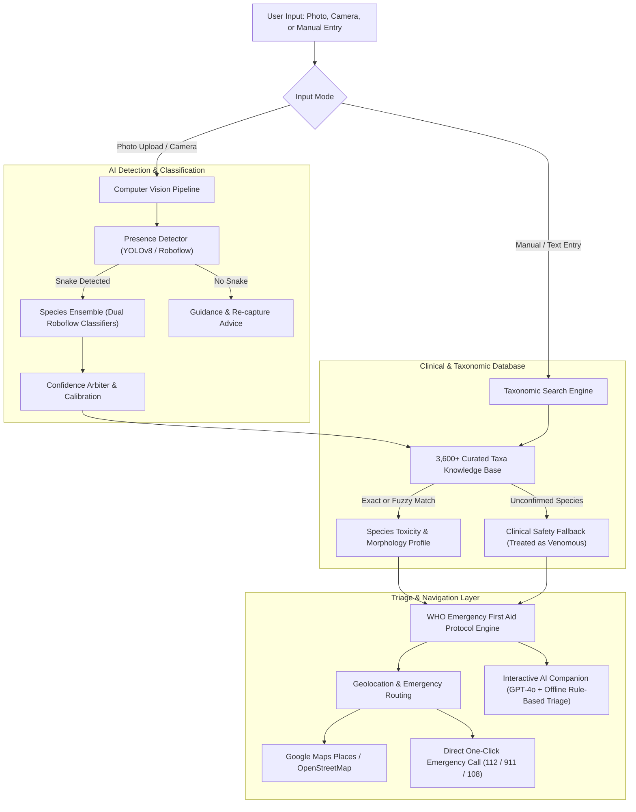

# 🛡️ VenomGuard

<div align="center">

[](https://github.com/niran/venomguard/actions)
[](https://www.python.org/downloads/)
[](LICENSE)
[](https://streamlit.io)
[](https://www.who.int/teams/control-of-neglected-tropical-diseases/snakebite-envenoming)

### Next-Gen AI-Powered Snakebite Emergency Management System
**Computer Vision Species Identification • WHO Clinical Triage • Antivenom Hospital Routing • Conversational AI Companion**

*Developed for the UGIP Hackathon by SoftBank & The University of Tokyo*

</div>

---

> [!NOTE]
> **Cloud Deployment Status**: The public cloud website demo is temporarily undergoing infrastructure and model upgrades and **will be back online soon!**  
> In the meantime, you can run VenomGuard locally in full or offline Demo Mode with a single command.

---

## 🌍 The Global Humanitarian Challenge & Why Open Source Matters

Snakebite envenoming is officially recognized by the **World Health Organization (WHO)** as one of the world's most severe **Neglected Tropical Diseases (NTDs)**.

```
       ANNUAL GLOBAL TOLL OF SNAKEBITE ENVENOMING
┌────────────────────────────────────────────────────────┐
│  5.4 MILLION Snakebite Incidents Annually              │
│  81,000 - 138,000 Deaths Each Year                     │
│  400,000+ Permanent Disabilities & Amputations         │
└────────────────────────────────────────────────────────┘
```

### The "Golden Hour" Emergency Gap
- **Disproportionate Impact**: Over 95% of snakebite casualties occur in impoverished agricultural and rural communities across South Asia (notably India), Sub-Saharan Africa, Southeast Asia, and Latin America.
- **The Lethal Cost of Folk Myths**: In the panic following a bite, victims and bystanders frequently apply arterial tourniquets, make razor incisions, attempt mouth suction, or apply freezing ice. The WHO explicitly warns that these unscientific practices cause severe tissue necrosis, gangrene, systemic infections, and amputation.
- **Antivenom Scarcity & Mismatch**: Antivenom is scarce, species-specific, and expensive. Patients are frequently brought to rural clinics that lack appropriate antivenoms or mechanical ventilation, losing critical hours during transport.

### The Role of Open Source
Most medical AI systems are walled off behind proprietary corporate platforms. **VenomGuard** is an open-source, community-governed public health initiative designed to:
1. Provide instant, free, reliable snake species identification and toxicity classification.
2. Deliver evidence-based **WHO clinical first aid protocols completely offline** — functioning even in remote wilderness or areas with zero cellular connectivity.
3. Guide rescuers directly to equipped emergency medical facilities stocking antivenom.
4. Support community health workers, wilderness travelers, and rural medical clinics worldwide.

---

## 🏗️ System Architecture

VenomGuard brings together a resilient multi-tier pipeline designed for high availability and offline continuity:



---

## 💡 Key Capabilities & Modules

### 1. 🔬 Computer Vision Snake Classifier
- **Multi-Model Inference**: Integrates presence detection and fine-grained species identification.
- **3,600+ Global Snake Database**: Maps taxonomic names to clinical toxicity indicators (e.g., neurotoxic ptosis, hemotoxic hemorrhage, cytotoxic necrosis).
- **Fuzzy String Matching**: Tolerates misspelled common or scientific names with resilient fallback algorithms.

### 2. 🚨 WHO-Compliant Emergency First Aid (100% Offline Capable)
- **Immediate Essential Actions (DO)**: Limb splinting and immobilization, removing restrictive jewelry, keeping the victim calm and still, tracking swelling boundaries.
- **Lethal Myths Dispelled (DO NOT)**: Explicitly forbids arterial tourniquets, cutting/incising, mouth suction, ice, and folk herbs.
- **Syndromic Triage**: Distinguishes neurotoxic (respiratory failure) from hemotoxic (coagulopathy) presentations.

### 3. 🏥 Resilient Hospital Locator & Emergency Dispatch
- **Multi-Provider Geolocation**: Seamless IP geolocation with reverse geocoding via OpenStreetMap Nominatim and Google Maps API.
- **Antivenom Routing**: Direct one-click turn-by-turn navigation to nearby emergency hospitals and poison control units.
- **1-Click Emergency Calling**: Direct phone links (`tel:112`) configured for mobile browser dialing.

### 4. 🤖 Conversational AI Medical Companion
- **Hybrid AI Architecture**: Powered by modern OpenAI language models (`gpt-4o-mini`) when online, with an intelligent, rule-based medical responder that answers questions even without an API key or internet access.

---

## 🚀 Quickstart Guide

### Prerequisites
- Python 3.9 to 3.12
- Conda or Python `venv`

### 1. Clone the Repository
```bash
git clone https://github.com/niran/venomguard.git
cd venomguard
```

### 2. Set Up Environment
Using Conda:
```bash
conda create -n venomguard python=3.10 -y
conda activate venomguard
pip install -r requirements.txt
```

Using standard Python `venv`:
```bash
python -m venv .venv
# On Windows:
.venv\Scripts\activate
# On Linux/macOS:
source .venv/bin/activate

pip install -r requirements.txt
```

### 3. Configure API Keys (Optional)
VenomGuard is engineered to work out of the box in **Demo Mode** and **Offline Mode** without any paid API keys!

To enable live external APIs (Roboflow, OpenAI, Google Maps), copy the environment template:
```bash
cp .env.example .env
```
Edit `.env` with your preferred credentials:
```ini
OPENAI_API_KEY=your_openai_key_here
GOOGLE_MAPS_API_KEY=your_google_maps_key_here
ROBOFLOW_API_KEY=your_roboflow_key_here
VENOMGUARD_DEMO_MODE=false
```

### 4. Run the Streamlit Application
```bash
streamlit run main.py
```
Open your browser at `http://localhost:8501`.

---

## 🧪 Running Unit Tests

VenomGuard includes an automated unit test suite verifying species matching, clinical triage protocols, offline responder intelligence, and hospital routing:

```bash
python -m unittest discover tests -v
```

Or using `pytest`:
```bash
pytest tests/ -v
```

---

## 📂 Repository Structure

```
venomguard/
├── .github/workflows/ci.yml       # GitHub Actions CI matrix (Ubuntu & Windows)
├── .editorconfig                  # Formatting and style standards
├── .env.example                   # Environment configuration template
├── .gitignore                     # Modern Git ignore rules
├── requirements.txt               # Production dependencies
├── requirements-dev.txt           # Testing & linting tools
├── packages.txt                   # Linux system packages for cloud hosting
├── LICENSE                        # MIT License
├── README.md                      # Project documentation & impact overview
├── main.py                        # Streamlit entry point and application router
│
├── AI_Code/                       # Machine Learning & Computer Vision
│   ├── detect_snake_existence.py  # Snake presence & species detection engine
│   ├── custom_snakes_data.csv     # Curated global dataset of 3,600+ snake taxa
│   └── Dataset/examples/          # Verified sample imagery for demo & testing
│
├── front/                         # Streamlit UI Views & Component Pages
│   ├── home.py                    # Landing page & deadliest snakes showcase
│   ├── upload_image_1.py          # Image capture, demo mode, and location form
│   ├── show_result_2.py           # Identification result & toxicity badge
│   ├── first_aid_3.py             # Emergency WHO first-aid cards & call buttons
│   ├── info_c1.py                 # Manual snake description entry
│   ├── chat_c2.py                 # Conversational emergency companion view
│   ├── about.py                   # Global health context & architecture
│   ├── partner.py                 # Institutional & government partnership tiers
│   └── error.py                   # Diagnostic guidance & recovery flows
│
├── function/                      # Core Clinical & Geolocation Engines
│   ├── who_guidelines.py          # WHO clinical first-aid protocol & triage engine
│   ├── location.py                # Geocoding & hospital locator routing
│   ├── first_aid.py               # Emergency first-aid orchestrator
│   └── llm_chat.py                # Conversational AI companion with offline fallback
│
└── tests/                         # Comprehensive Unit Test Suite
    ├── test_detection.py          # Species taxonomy & fuzzy matching tests
    ├── test_who_guidelines.py     # WHO first aid & syndromic triage tests
    ├── test_location.py           # Geolocation & hospital routing tests
    └── test_chat.py               # Emergency conversational responder tests
```

---

## 👥 Authors & Recognition

VenomGuard was originally designed and built for the **UGIP Hackathon by SoftBank & The University of Tokyo**:

- **Niran N** — Lead Architecture & Engineering ([niran.dev](https://niran.dev/) / [@Niran](https://github.com/niran))
- **Miyuki** — ML Research & Public Health Workflow
- **Yuki** — Clinical Research & Design

---

## 📄 License

This project is licensed under the **MIT License** — see the [LICENSE](LICENSE) file for details.
We actively encourage humanitarian organizations, herpetologists, public health researchers, and developers to fork, extend, and deploy VenomGuard to protect at-risk communities worldwide.
