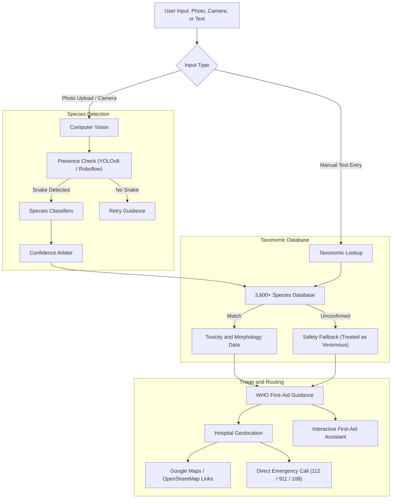

# VenomGuard

[](https://github.com/niran/venomguard/actions)
[](https://www.python.org/downloads/)
[](LICENSE)
[](https://streamlit.io)

Open-source snakebite identification, emergency first-aid triage, and antivenom hospital locator. Originally built for the SoftBank and University of Tokyo UGIP Hackathon.

Note: The public deployment demo is temporarily down for an infrastructure update and will be back online shortly. You can run the application locally or in demo mode using the instructions below.

---

## The Problem

Snakebite envenoming is recognized by the World Health Organization (WHO) as a high-priority Neglected Tropical Disease.

```
Annual global burden of snakebites:
- 5.4 million snakebite incidents
- 81,000 to 138,000 deaths
- 400,000+ permanent disabilities and amputations
```

Most deaths occur in rural agricultural communities in South Asia, Sub-Saharan Africa, and Latin America. In many cases, the fatal factor is not just the venom itself, but what happens during the first hour after the bite:

1. Harmful first-aid practices: Under panic, patients and bystanders frequently apply arterial tourniquets, make razor blade incisions, attempt mouth suction, or apply ice. The WHO explicitly warns against these practices; they cause tissue death, gangrene, severe infections, and limb loss.
2. Hospital mismatches: Antivenom is scarce, expensive, and species-specific. Patients are often brought to local dispensaries that do not carry antivenom or ventilators, losing critical hours during transfer.
3. Species misidentification: Clinicians need to know what species bit the patient to select the correct monovalent or polyvalent antivenom.

VenomGuard is designed to address these gaps directly on mobile devices, with full offline fallbacks when cellular connection is unavailable.

---

## Architecture

The system coordinates computer vision, a taxonomic reference dataset, and emergency routing:



---

## Core Features

### 1. Snake Identification
Uses multi-stage inference to confirm whether an image contains a snake, then classifies the species. Queries an internal database of over 3,600 snake taxa with scientific names, venom toxicity ratings, and typical sizes. If external inference APIs are unreachable, it falls back to local heuristic matching.

### 2. WHO-Compliant First-Aid Guidance
Strictly adheres to World Health Organization clinical management protocols:
- Essential steps: complete physical immobilization, limb splinting below heart level, rapid removal of rings and tight clothing, and recording swelling borders over time.
- Myth dispelling: explicitly prohibits arterial tourniquets, incisions, suction, ice, and folk herbs.
- Syndromic categorization: differentiates neurotoxic (respiratory arrest, drooping eyelids) from hemotoxic (coagulopathy, uncontrolled bleeding) and cytotoxic presentations.
- 100% offline continuity: all protocols are bundled locally and require no internet access.

### 3. Emergency Hospital Locator
Uses device IP geolocation or manual entry, reverse geocodes with OpenStreetMap Nominatim or Google Maps, and generates direct navigation links to nearby emergency facilities. Includes one-tap telephone dialing for emergency dispatch (112, 911, 108).

### 4. Interactive First-Aid Companion
Provides an interactive chat interface powered by OpenAI when connected, backed by a deterministic, rule-based clinical responder that answers common questions offline.

---

## Quickstart

### Prerequisites
- Python 3.9 through 3.12
- Conda or Python `venv`

### 1. Clone the repository
```bash
git clone https://github.com/niran/venomguard.git
cd venomguard
```

### 2. Set up the environment
Using `venv`:
```bash
python -m venv .venv

# On Linux/macOS:
source .venv/bin/activate

# On Windows:
.venv\Scripts\activate

pip install -r requirements.txt
```

### 3. Optional configuration
VenomGuard works immediately in demo and offline modes without any external API keys.

To enable live external services (OpenAI, Google Maps, Roboflow), copy the configuration template:
```bash
cp .env.example .env
```
Add your keys to `.env`:
```ini
OPENAI_API_KEY=your_key_here
GOOGLE_MAPS_API_KEY=your_key_here
ROBOFLOW_API_KEY=your_key_here
VENOMGUARD_DEMO_MODE=false
```

### 4. Run the application
```bash
streamlit run main.py
```
Open `http://localhost:8501` in your browser.

---

## Running Tests

VenomGuard includes an automated unit test suite covering species taxonomy, fuzzy string matching, WHO triage protocols, offline chat responses, and hospital routing:

```bash
python -m unittest discover tests -v
```

---

## Project Structure

```
venomguard/
├── .github/workflows/ci.yml       # Automated GitHub Actions test workflow
├── .editorconfig                  # Code formatting rules
├── .env.example                   # Environment variable template
├── .gitignore                     # Git ignore rules
├── requirements.txt               # Application dependencies
├── requirements-dev.txt           # Testing and development dependencies
├── packages.txt                   # Linux system packages for cloud hosting
├── LICENSE                        # MIT License
├── README.md                      # Documentation
├── main.py                        # Streamlit entry point and router
│
├── AI_Code/                       # Model inference and taxonomy data
│   ├── detect_snake_existence.py  # Species detection and lookup engine
│   ├── custom_snakes_data.csv     # Database of 3,600+ snake species
│   └── Dataset/examples/          # Sample images for testing
│
├── front/                         # UI pages and components
│   ├── home.py                    # Landing page and reference snakes
│   ├── upload_image_1.py          # Photo capture and upload form
│   ├── show_result_2.py           # Identification results view
│   ├── first_aid_3.py             # First aid and emergency call screen
│   ├── info_c1.py                 # Manual species entry form
│   ├── chat_c2.py                 # Chat interface
│   ├── about.py                   # Background and clinical rationale
│   ├── partner.py                 # Partnership information
│   └── error.py                   # Detection troubleshooting view
│
├── function/                      # Core logic and services
│   ├── who_guidelines.py          # WHO first-aid protocols and triage rules
│   ├── location.py                # Geolocation and hospital search
│   ├── first_aid.py               # First-aid coordinator
│   └── llm_chat.py                # Conversational assistant and offline fallback
│
└── tests/                         # Unit tests
    ├── test_detection.py          # Species taxonomy tests
    ├── test_who_guidelines.py     # WHO protocol tests
    ├── test_location.py           # Location and hospital link tests
    └── test_chat.py               # Offline responder tests
```

---

## Authors

Originally created for the SoftBank and University of Tokyo UGIP Hackathon by:
- Niran N ([niran.dev](https://niran.dev/))
- Miyuki
- Yuki

---

## License

This project is licensed under the MIT License. See [LICENSE](LICENSE) for details.
